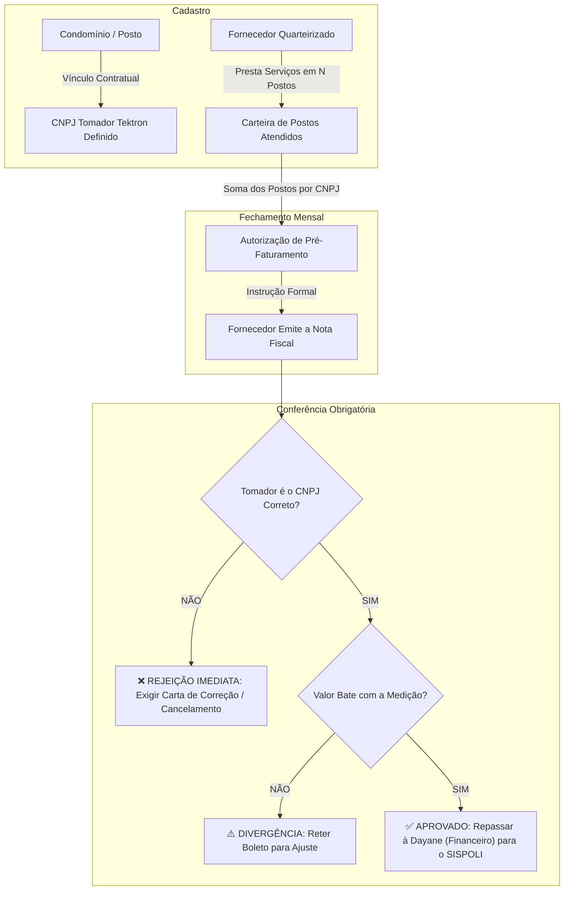
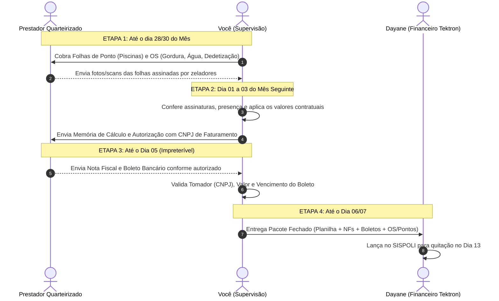

# MANUAL PRÁTICO & APRESENTAÇÃO OPERACIONAL
## Supervisão e Gestão de Quarteirizados — Grupo Tektron
**Responsável Operacional:** Cléber Donato  
**Alinhamento de Integração:** Marcos César (Ouvidoria) & Murilo Filho (Diretoria)

---

## 1. Visão Geral da Responsabilidade

A supervisão de quarteirizados é o elo técnico e fiscal entre:
1. **O Cliente (Condomínio / Síndico / Zelador)** — Quem recebe o serviço e atesta a presença/qualidade.
2. **O Prestador Quarteirizado (Piscineiro, Jardineiro, Desentupidora)** — Quem executa e fatura.
3. **O Comercial Tektron** — Quem vende e guarda o contrato original.
4. **O Financeiro Tektron (Dayane)** — Quem só aceita notas fiscais conferidas e amparadas por ordens de serviço/folhas de ponto para lançar no sistema **SISPOLI**.

> [!IMPORTANT]
> **A Regra de Ouro da Tektron:** O prestador **NÃO** emite a nota fiscal do jeito que quiser. Primeiro você apura a medição com base nas folhas de ponto/OS, valida o valor exato na planilha e autoriza formalmente a emissão da NF indicando expressamente **qual CNPJ da Tektron** deve figurar como tomador.

---

## 2. Regra Estratégica: Validação Fiscal Cruzada dos CNPJs Tomadores

A Tektron não fatura tudo sob uma única empresa. O grupo atua através de **4 empresas jurídicas**:

| Empresa do Grupo | CNPJ | Onde se aplica tipicamente |
|---|---|---|
| **TEKTRON CONSERVAÇÃO E LIMPEZA LTDA** | `47.409.091/0001-87` | Condomínios padrão com portaria/limpeza integrada (ex: Alegria, Atmosphere, Mara Edifício) |
| **TEKTRON SERVIÇOS LIMPEZA E CONSERVAÇÃO LTDA** | `60.189.919/0001-05` | Postos novos iniciados em 2025/2026 (ex: Arte Verde Marista, Casa Blanca, Copas do Bosque) |
| **GYN CONSERVAÇÃO E LIMPEZA LTDA** | `10.790.900/0001-33` | Carteiras tradicionais e postos comerciais (ex: Alessandra Reis, Montese, Neusa Moraes, Searas Bueno) |
| **TEKTRON ADMINISTRAÇÃO E SERVIÇOS LTDA** | `01.388.968/0001-08` | Contratos corporativos e sede administrativa |



### O que consta no cadastro do fornecedor no ClickUp:
1. **Quais CNPJs o contratam:** Um fornecedor como a **TN** atende condomínios faturados pela *Tektron Conservação*, outros pela *Tektron Serviços* e outros pela *GYN*. No ClickUp, o cadastro do fornecedor lista todos os CNPJs tomadores elegíveis.
2. **Checklist da Nota Fiscal:** No momento em que o fornecedor anexa o PDF/XML da NF:
   - Se o condomínio for *Montese*, a NF **TEM** que sair contra a **GYN**. Se sair contra a Tektron Serviços, **a Dayane devolve a nota**.
   - O campo no ClickUp fica marcado como `VAL_TOMADOR: CONFORME` ou `VAL_TOMADOR: ERRO_TOMADOR`.

---

## 3. O Ciclo Mensal em 4 Etapas Práticas



---

## 4. Planejamento das Atividades Diárias (Rotina do Gestor)

Conforme alinhado no documento de **Atividade supervisão quarteirizados (02.03)** e nas instruções de transição do Marcos, sua jornada de trabalho distribui-se entre **rotinas diárias fixas** e **janelas mensais específicas**:

### Grade de Rotina Diária (Horário: 07:00 às 17:00)

| Horário | Atividade | Procedimento Relacionado |
|---|---|---|
| **07:00 - 08:30** | **Ronda Operacional & WhatsApp:**<br>- Abrir mensagens de síndicos, zeladores e do Comercial.<br>- Registrar reclamações ou solicitações recebidas.<br>- Cobrar prestadores sobre imprevistos do dia anterior. | Item 02.03.8 / 02.03.9 / 02.03.10 |
| **08:30 - 11:30** | **Acompanhamento de Campo & Execuções:**<br>- Conferir na planilha/sistema a programação da semana (janela de ±3 dias).<br>- Validar se prestadores de Caixas de Gordura e Água estão nos condomínios programados.<br>- Tratar solicitações de orçamentos demandadas pelo Comercial. | Item 02.03.11 / 02.03.15 |
| **11:30 - 12:00** | **Organização de Documentos:**<br>- Baixar Ordens de Serviço e folhas de ponto recebidas via WhatsApp e salvar na pasta do cliente no Drive. | Item 02.03.3 |
| **13:00 - 15:30** | **Foco Conforme Período do Mês (Ver Calendário Abaixo)** | Item 02.03.4 / 02.03.5 / 02.03.12 |
| **15:30 - 16:30** | **Alinhamento Comercial / Financeiro:**<br>- Resposta a orçamentos para o Comercial.<br>- Devolutiva a Dayane (Financeiro) sobre dúvidas de NFs ou boletos.<br>- Tratamento de não conformidades com prestadores (advertências). | Item 02.03.6 / Item 02.03.14 |
| **16:30 - 17:00** | **Log Diário de Atividades & Demandas:**<br>- Registro das tarefas concluídas na planilha *Registro de Demandas WhatsApp* e conciliação do dia. | Item 3 (Controle de Registros) |

---

### Janelas Críticas do Mês

```
 ┌──────────────────────┬──────────────────────┬──────────────────────┬──────────────────────┐
 │  DIA 25 AO DIA 30    │   DIA 01 AO DIA 05   │   DIA 06 AO DIA 10   │   DIA 15 AO DIA 24   │
 ├──────────────────────┼──────────────────────┼──────────────────────┼──────────────────────┤
 │  COLETA DE PONTO/OS  │ PRÉ-MEDIÇÃO & NOTAS  │  REPASSE FINANCEIRO  │  QUALIDADE E AUDITORIA│
 │                      │                      │                      │                      │
 │ - Cobrar piscineiros │ - Fechar planilha    │ - Entregar pacote    │ - Avaliação mensal   │
 │   as folhas assinadas│ - Autorizar NFs      │   para a Dayane      │   dos prestadores    │
 │ - Coletar OSs de cx  │ - Conferir CNPJ      │ - Acompanhar baixa   │ - Dossiê anual e NRs │
 │   gordura e água     │   tomador e boletos  │   para o dia 13      │ - Vistorias e aditivo│
 └──────────────────────┴──────────────────────┴──────────────────────┴──────────────────────┘
```

---

## 5. Casos Práticos: O Que Fazer em Cada Situação?

### Caso 1: O Síndico liga furioso dizendo que o piscineiro não foi
1. Abra a pasta do condomínio ou o ClickUp.
2. Verifique qual empresa atende o posto (ex: Sempre Limpa, H2O, Dourado) e os dias combinados (ex: terças e sextas).
3. Acione o supervisor da empresa terceirizada pelo WhatsApp com prazo de resposta de até 2 horas.
4. Se o prestador faltou sem aviso: emitir advertência formal (WhatsApp + registro no ClickUp).
5. Se houver reincidência: abrir pauta de substituição conforme Cláusula 02.03.6.

### Caso 2: O prestador enviou a Nota Fiscal com o CNPJ errado
1. Exemplo: O condomínio é *Montese* (contratado pela GYN), mas a NF veio emitida para a *Tektron Conservação*.
2. **NÃO envie para a Dayane.**
3. Devolva imediatamente ao fornecedor:
   > *"Prezado, a nota fiscal nº XXX foi emitida com o CNPJ tomador divergente. Para o condomínio Montese, a empresa tomadora contratual é GYN CONSERVAÇÃO E LIMPEZA LTDA (CNPJ 10.790.900/0001-33). Favor emitir carta de correção ou cancelamento e reemissão para prosseguirmos com a liberação do pagamento."*

### Caso 3: O Comercial pede orçamento de serviço novo
1. O Comercial avisa: *"Cléber, preciso de orçamento de piscina e caixa d'água para o cliente X"*.
2. Você aciona dois prestadores homologados da região (ex: H2O e Sempre Limpa).
3. Passa o contato do síndico/zelador para que façam a visita técnica.
4. Recebe o orçamento do prestador, confere se o valor por m³ ou visita está dentro do parâmetro e devolve a cotação ao Comercial.

---

## 6. Checklist de Entrega para a Dayane (Financeiro)

Para cada lote mensal de pagamento, o checklist obrigatório contém:
- [ ] **Planilha de Pagamento Mensal Consolidada** (com valores de 2026 reajustados).
- [ ] **Notas Fiscais em PDF** (com conferência de CNPJ tomador aprovada).
- [ ] **Boletos Bancários** (com vencimento compatível para liquidação no dia 13).
- [ ] **Ordens de Serviço e Folhas de Ponto** assinadas e arquivadas no drive.
- [ ] **Certidões Negativas do Prestador** (CND, CNDT e FGTS) em dia.
